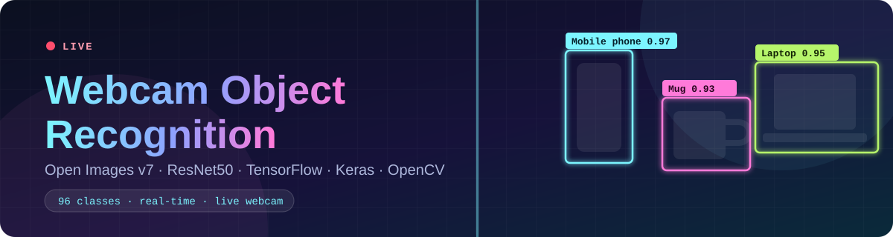

Claude


Readme · MD
<div align="center">

<br/>


 
### Recognize everyday objects live on your webcam
A **ResNet50** model adapted with **transfer learning** and **fine-tuning**, trained on **Open Images v7**.
 
[🧭 Pipeline](#-pipeline) &nbsp;•&nbsp; [📍 Roadmap](#-roadmap) &nbsp;•&nbsp; [🔖 Classes](#-classes) &nbsp;•&nbsp; [📦 Dataset](#-dataset) &nbsp;•&nbsp; [🧠 Model](#-model) &nbsp;•&nbsp; [🚀 Quick start](#-quick-start)
 
</div>
---
 
<table align="center">
  <tr>
    <td align="center"><h2>96</h2>target classes</td>
    <td align="center"><h2>96k</h2>train images</td>
    <td align="center"><h2>19k</h2>validation images</td>
    <td align="center"><h2>ResNet50</h2>backbone</td>
  </tr>
</table>
> **Status:** work in progress. The dataset is being prepared; training and the live webcam demo come next. The image counts above come from the per-class download targets (1,000 train and 200 validation images per class).
 
## 🧭 Pipeline

```mermaid
flowchart LR
    A["Open Images v7<br/>96 chosen classes"] -->|FiftyOne| B["Download<br/>96k train + 19k val"]
    B --> C["Crop objects<br/>OpenCV"]
    C --> D["Transfer learning<br/>frozen ResNet50"]
    D --> E["Fine-tuning<br/>unfreeze top layers"]
    E --> F["Evaluate<br/>accuracy, top-3"]
    F --> G["Live webcam<br/>OpenCV"]
 
    classDef done fill:#16a34a,stroke:#15803d,color:#fff;
    classDef wip fill:#f59e0b,stroke:#b45309,color:#fff;
    classDef todo fill:#334155,stroke:#475569,color:#e2e8f0;
    class A done;
    class B wip;
    class C,D,E,F,G todo;
```
 

 
## 📍 Roadmap
 
```text
Progress  ▰▰▱▱▱▱▱▱▱▱   2 of 10 steps done
```
 
| # | Step | Status |
|:-:|------|:------:|
| 1 | Environment: TensorFlow and Keras with GPU, OpenCV, FiftyOne (WSL2) | ✅ Done |
| 2 | Select and validate 96 target classes | ✅ Done |
| 3 | Download the train split (1,000 images per class, about 96,000 images) | ⏳ In progress |
| 4 | Download the validation split (200 images per class, about 19,200 images) | 🔜 Next |
| 5 | Crop the annotated objects into one folder per class (OpenCV) | 📋 Planned |
| 6 | Check class balance | 📋 Planned |
| 7 | Transfer learning: train a new head on a frozen ResNet50 | 📋 Planned |
| 8 | Fine-tuning: unfreeze the top layers with a low learning rate | 📋 Planned |
| 9 | Evaluate (accuracy, top-3 accuracy, confusion matrix) | 📋 Planned |
| 10 | Live webcam demo with OpenCV | 📋 Planned |
 
## 🔖 Classes
 
96 everyday objects that are likely to appear in front of a webcam. Names match the official Open Images class list exactly.
 
<details>
<summary><b>💻 Electronics</b> (12)</summary>
<br/>
`Mobile phone` `Laptop` `Camera` `Computer keyboard` `Computer mouse` `Headphones` `Tablet computer` `Computer monitor` `Television` `Remote control` `Microphone` `Calculator`
 
</details>
<details>
<summary><b>✏️ Stationery and office</b> (9)</summary>
<br/>
`Book` `Scissors` `Pen` `Ruler` `Stapler` `Eraser` `Pencil case` `Envelope` `Whiteboard`
 
</details>
<details>
<summary><b>🍽️ Kitchen and tableware</b> (12)</summary>
<br/>
`Mug` `Bottle` `Coffee cup` `Plate` `Bowl` `Spoon` `Fork` `Knife` `Teapot` `Kettle` `Wine glass` `Tin can`
 
</details>
<details>
<summary><b>🍎 Fruit and vegetables</b> (15)</summary>
<br/>
`Grape` `Strawberry` `Pear` `Peach` `Pineapple` `Watermelon` `Mango` `Banana` `Apple` `Orange` `Lemon` `Tomato` `Carrot` `Cucumber` `Potato`
 
</details>
<details>
<summary><b>🍕 Meals and fast food</b> (8)</summary>
<br/>
`Pizza` `Hamburger` `Hot dog` `French fries` `Sandwich` `Fast food` `Popcorn` `Salad`
 
</details>
<details>
<summary><b>🥐 Bakery and sweets</b> (9)</summary>
<br/>
`Bread` `Bagel` `Pretzel` `Muffin` `Croissant` `Cake` `Cookie` `Candy` `Ice cream`
 
</details>
<details>
<summary><b>🥤 Drinks</b> (6)</summary>
<br/>
`Milk` `Juice` `Tea` `Beer` `Wine` `Cocktail`
 
</details>
<details>
<summary><b>🎒 Personal items</b> (10)</summary>
<br/>
`Glasses` `Clock` `Backpack` `Watch` `Sunglasses` `Hat` `Handbag` `Umbrella` `Toothbrush` `Towel`
 
</details>
<details>
<summary><b>🏠 Home and decor</b> (7)</summary>
<br/>
`Lamp` `Picture frame` `Houseplant` `Vase` `Pillow` `Candle` `Mirror`
 
</details>
<details>
<summary><b>🙋 People, pets and more</b> (8)</summary>
<br/>
`Person` `Chair` `Human face` `Human hand` `Cat` `Dog` `Teddy bear` `Dumbbell`
 
</details>
## 📦 Dataset
 
Images and bounding boxes come from [Open Images v7](https://storage.googleapis.com/openimages/web/index.html) and are downloaded through [FiftyOne](https://docs.voxel51.com/). Each class is downloaded separately, so every class gets a similar number of images instead of letting frequent classes such as Person dominate.
 
```python
import fiftyone as fo
import fiftyone.zoo as foz
 
train_ds = fo.Dataset("train_dataset", persistent=True)
 
for i, label in enumerate(labels):            # the 96 class names
    ds = foz.load_zoo_dataset(
        "open-images-v7",
        split="train",
        classes=[label],
        label_types=["detections"],
        max_samples=1000,                     # images per class
        shuffle=True,
        seed=i,
        dataset_name=f"tmp_train_{i}",
    )
    train_ds.add_samples(ds)
    ds.delete()
 
# The validation split uses the same loop with split="validation",
# max_samples=200 and dataset_name="validation_dataset".
```
 
- The bounding boxes are used to **crop each annotated object** with OpenCV, which gives one folder per class. Only boxes of the 96 target classes are cropped. The folders are then loaded with `keras.utils.image_dataset_from_directory`.
- The dataset is **not** stored in this repository because of its size. Run the notebook to download it. The first run fetches large metadata files (about 4.8 GB), and the images are cached in `~/fiftyone/open-images-v7`. If the download is interrupted, run the cell again: images that are already cached are not downloaded twice.
- `max_samples` is the number of images **per class** (1,000 for train, 200 for validation), which gives about 96,000 train and 19,200 validation images. An image that contains several target classes can be selected more than once, and rare classes can have fewer images than the target. Class balance is checked after the download.
- Open Images annotations are licensed under CC BY 4.0 and the images are listed as CC BY 2.0 by their authors. See the [official page](https://storage.googleapis.com/openimages/web/factsfigures_v7.html) for details.
## 🧠 Model
 
The model starts from **ResNet50 pretrained on ImageNet** (`keras.applications`) and is adapted in two phases.
 
| Phase | What is trained | Learning rate |
|-------|-----------------|:-------------:|
| **1. Transfer learning** | Only the new head (global average pooling, dropout, softmax layer). The ResNet50 backbone is frozen. | `1e-3` |
| **2. Fine-tuning** | The last layers of ResNet50 are unfrozen and trained together with the head. BatchNorm layers stay frozen. | `1e-5` |
 
```python
import keras
from keras import layers
 
base = keras.applications.ResNet50(weights="imagenet", include_top=False, input_shape=(224, 224, 3))
base.trainable = False                                   # phase 1
 
inputs = keras.Input((224, 224, 3))
x = keras.applications.resnet50.preprocess_input(inputs)
x = base(x, training=False)
x = layers.GlobalAveragePooling2D()(x)
x = layers.Dropout(0.3)(x)
outputs = layers.Dense(96, activation="softmax")(x)
model = keras.Model(inputs, outputs)
```
 
At inference time, OpenCV reads the webcam, takes a square region in the middle of the frame, feeds it to the model and draws the predicted class and probability on the video.
 
> This section describes the plan and may change as the project moves forward.
 
## 🚀 Quick start
 
```bash
git clone https://github.com/YOUR_USERNAME/YOUR_REPO.git
cd YOUR_REPO
 
python3 -m venv ai-env
source ai-env/bin/activate            # Windows: ai-env\Scripts\activate
 
python -m pip install "tensorflow[and-cuda]" fiftyone opencv-python jupyterlab pandas scikit-learn matplotlib
 
python -c "import tensorflow as tf; print(tf.config.list_physical_devices('GPU'))"
jupyter lab
```
 
Open the notebook and run the cells from top to bottom.
 
## 📁 Project structure
 
```text
.
├── assets/
│   └── banner.svg
├── <your-notebook>.ipynb      # dataset preparation (current stage)
├── .gitignore
├── LICENSE
└── README.md
```
 
## 📝 Notes
 
- Train in WSL2 or Linux with an NVIDIA GPU. TensorFlow does not support GPUs on native Windows, but the trained model runs fine on the CPU there for the webcam demo.
- Webcam access (`cv2.VideoCapture`) and `cv2.imshow` work best on native Windows or Linux, so run the live demo there.
- Keep `~/fiftyone`, the cropped dataset, saved models (`.keras`) and `.env` files out of Git.
- Plan for roughly 20 to 40 GB of free disk space for the image cache and the cropped dataset.
- On WSL2, the default memory limit is half of your RAM. If WSL disconnects during the download, raise it in `C:\Users\<you>\.wslconfig` (for example `memory=11GB`) and run `wsl --shutdown`.
## 🙏 Acknowledgements
 
[Open Images](https://storage.googleapis.com/openimages/web/index.html) by Google, [FiftyOne](https://docs.voxel51.com/) by Voxel51, [TensorFlow](https://www.tensorflow.org/) and [Keras](https://keras.io/), [OpenCV](https://opencv.org/).
 
## 📄 License
 
Released under the [MIT License](LICENSE).
 
<div align="center">
<sub>Built step by step, one notebook cell at a time.</sub>
 
</div>
 
Claude finished the response
