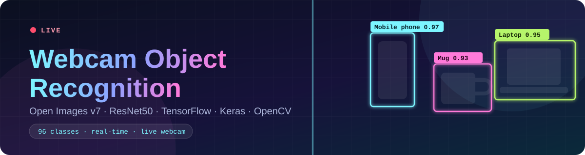
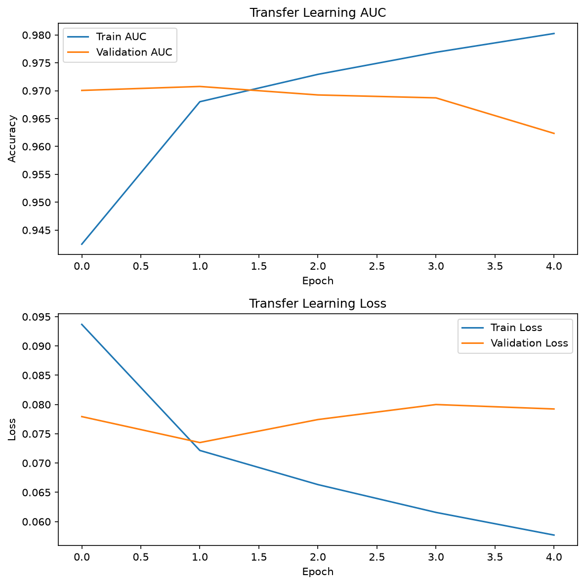
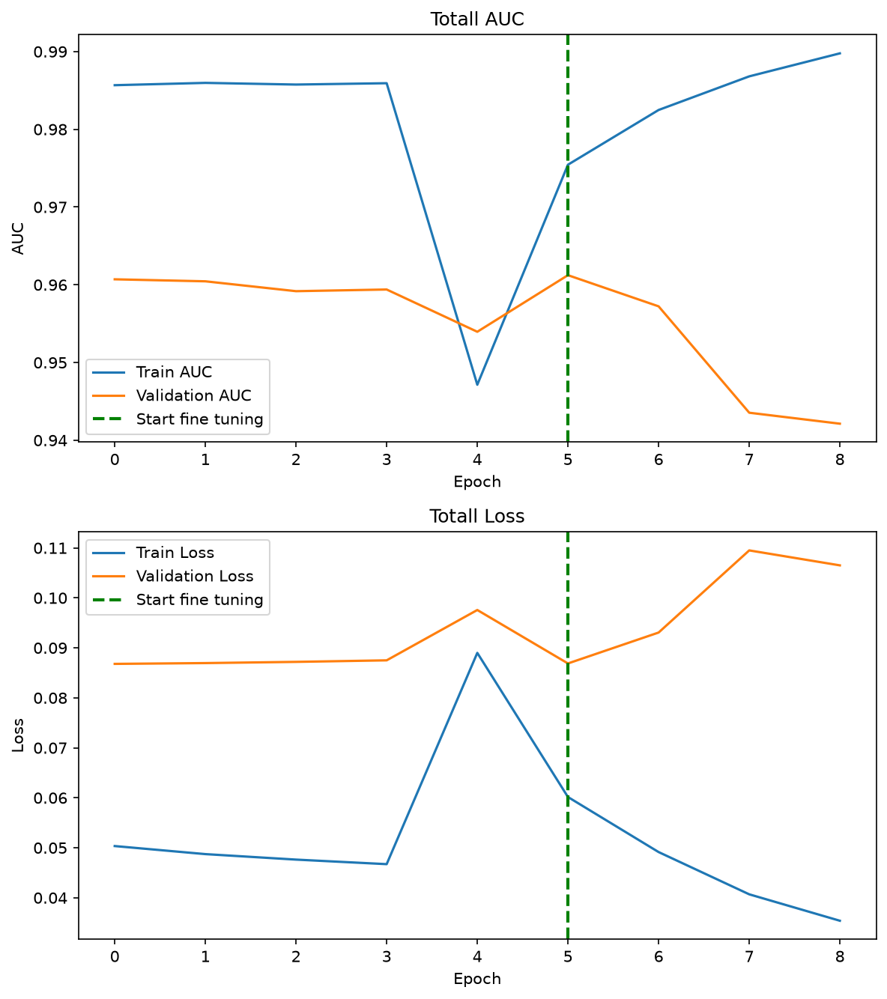

<div align="center">



<br/>


<h3>Recognize everyday objects live on your webcam</h3>
<p>A <b>ResNet50</b> model adapted with <b>transfer learning</b> and <b>fine-tuning</b>, trained on <b>Open Images v7</b>.</p>

[🧭 Pipeline](#-pipeline) &nbsp;•&nbsp; [📍 Roadmap](#-roadmap) &nbsp;•&nbsp; [🔖 Classes](#-classes) &nbsp;•&nbsp; [📦 Dataset](#-dataset) &nbsp;•&nbsp; [🧠 Model](#-model) &nbsp;•&nbsp; [🚀 Quick start](#-quick-start)

</div>

---

<table align="center">
  <tr>
    <td align="center"><h2>30</h2>target classes</td>
    <td align="center"><h2>22k</h2>train images</td>
    <td align="center"><h2>2.1k</h2>validation images</td>
    <td align="center"><h2>ResNet50</h2>backbone</td>
  </tr>
</table>

> **Status:** work in progress. The dataset is downloaded and the multi-hot labels are ready; transfer learning and fine-tuning are complete, including callback-based checkpointing and learning-curve analysis. The final per-class evaluation and live webcam demo come next. The image counts above are unique images after merging duplicates (26,142 train and 2,673 validation images were downloaded, of which 22,388 and 2,093 are unique). The targets were 1,000 train and 300 validation images per class, but some classes have fewer images available.

## 🧭 Pipeline


## 📍 Roadmap

<div align="center">

`Progress ▰▰▰▰▰▰▰▰▰▱▱ 9 of 11 steps done`

<table align="center">
  <thead>
    <tr>
      <th align="center" width="6%">#</th>
      <th align="left">Step</th>
      <th align="center" width="18%">Status</th>
    </tr>
  </thead>
  <tbody>
    <tr>
      <td align="center">1</td>
      <td>Environment: TensorFlow and Keras with GPU, OpenCV, FiftyOne (WSL2)</td>
      <td align="center">✅ Done</td>
    </tr>
    <tr>
      <td align="center">2</td>
      <td>Select and validate 30 target classes</td>
      <td align="center">✅ Done</td>
    </tr>
    <tr>
      <td align="center">3</td>
      <td>Download the train split (up to 1,000 images per class, 26,142 images)</td>
      <td align="center">✅ Done</td>
    </tr>
    <tr>
      <td align="center">4</td>
      <td>Download the validation split (up to 300 images per class, 2,673 images)</td>
      <td align="center">✅ Done</td>
    </tr>
    <tr>
      <td align="center">5</td>
      <td>Keep only the 30 target classes (filtered FiftyOne views)</td>
      <td align="center">✅ Done</td>
    </tr>
    <tr>
      <td align="center">6</td>
      <td>Build multi-hot labels from the whole image (multi-label, no cropping)</td>
      <td align="center">✅ Done</td>
    </tr>
    <tr>
      <td align="center">7</td>
      <td>Merge duplicate images (22,388 train and 2,093 validation unique images)</td>
      <td align="center">✅ Done</td>
    </tr>
    <tr>
      <td align="center">8</td>
      <td>Transfer learning: input pipeline (tf.data), data augmentation and a new sigmoid head on a frozen ResNet50 (validation AUC 0.962)</td>
      <td align="center">✅ Done</td>
    </tr>
    <tr>
      <td align="center">9</td>
      <td>Fine-tuning: unfreeze the last 30 layers with a low learning rate (the validation AUC drops after the first epoch, see below)</td>
      <td align="center">⏳ In progress</td>
    </tr>
    <tr>
      <td align="center">10</td>
      <td>Evaluate (AUC, precision and recall per class)</td>
      <td align="center">📋 Planned</td>
    </tr>
    <tr>
      <td align="center">11</td>
      <td>Live webcam demo with OpenCV</td>
      <td align="center">📋 Planned</td>
    </tr>
  </tbody>
</table>

</div>

## 🔖 Classes

30 everyday objects that are likely to appear in front of a webcam. Names match the official Open Images class list exactly.

<details>
<summary><b>💻 Electronics</b> (8)</summary>
<br/>

`Mobile phone` `Laptop` `Computer keyboard` `Computer mouse` `Headphones` `Computer monitor` `Remote control` `Camera`

</details>

<details>
<summary><b>✏️ Office items</b> (4)</summary>
<br/>

`Book` `Pen` `Scissors` `Calculator`

</details>

<details>
<summary><b>🍽️ Kitchen and tableware</b> (8)</summary>
<br/>

`Mug` `Bottle` `Coffee cup` `Plate` `Bowl` `Spoon` `Fork` `Knife`

</details>

<details>
<summary><b>🎒 Personal items</b> (4)</summary>
<br/>

`Glasses` `Watch` `Backpack` `Clock`

</details>

<details>
<summary><b>🍎 Fruit</b> (3)</summary>
<br/>

`Banana` `Apple` `Orange`

</details>

<details>
<summary><b>🙋 People</b> (3)</summary>
<br/>

`Person` `Human face` `Human hand`

</details>

## 📦 Dataset

Images and bounding boxes come from [Open Images v7](https://storage.googleapis.com/openimages/web/index.html) and are downloaded through [FiftyOne](https://docs.voxel51.com/). Each class is downloaded separately, so every class gets a similar number of images instead of letting frequent classes such as Person dominate.

```python
import fiftyone as fo
import fiftyone.zoo as foz

train_ds = fo.Dataset("train_dataset", persistent=True)

for i, label in enumerate(labels):            # the 30 class names
    ds = foz.load_zoo_dataset(
        "open-images-v7",
        split="train",
        classes=[label],
        label_types=["detections"],
        max_samples=1000,                     # images per class
        shuffle=True,
        seed=i,
        dataset_name=f"tmp_train_{i}",
    )
    train_ds.add_samples(ds)
    ds.delete()
```

The validation split is downloaded the same way, with up to 300 images per class:

```python
val_ds = fo.Dataset("validation_dataset", persistent=True)

for i, label in enumerate(labels):
    ds = foz.load_zoo_dataset(
        "open-images-v7",
        split="validation",
        classes=[label],
        label_types=["detections"],
        max_samples=300,                      # images per class
        shuffle=True,
        seed=i,
        dataset_name=f"tmp_val_{i}",
    )
    val_ds.add_samples(ds)
    ds.delete()
```

- The objects are **not** cropped. The bounding boxes are only used to find which of the 30 target classes appear in each image, and the model looks at the **whole image** (multi-label classification, see below).
- The dataset is **not** stored in this repository because of its size. Run the notebook to download it. The first run fetches large metadata files (about 4.8 GB), and the images are cached in `~/fiftyone/open-images-v7`. If the download is interrupted, run the cell again: images that are already cached are not downloaded twice.
- `max_samples` is the number of images **per class** (up to 1,000 for train, up to 300 for validation). Some classes have fewer images available, especially in the much smaller validation split, so the downloaded datasets have 26,142 train and 2,673 validation samples. An image that contains several target classes can be selected more than once, so duplicates are merged after the labels are built (22,388 train and 2,093 validation unique images).
- Both datasets are created with `persistent=True`, so later sessions only need `fo.load_dataset("train_dataset")` and `fo.load_dataset("validation_dataset")`. Do not run the download cells again: they delete and rebuild the datasets.
- Open Images annotations are licensed under CC BY 4.0 and the images are listed as CC BY 2.0 by their authors. See the [official page](https://storage.googleapis.com/openimages/web/factsfigures_v7.html) for details.

To look at the images and their bounding boxes, open the dataset in the FiftyOne app:

```python
session = fo.launch_app(train_ds)     # opens in the notebook or at http://localhost:5151
```

The app shows every image with its boxes and class names, and the sidebar can filter the images by label (for example only `Laptop`). This step is optional and only meant for exploring the data. Close the app with `session.close()`.

### Keep only the target classes

The images carry the labels of every object that Open Images annotated, not only the 30 target classes (for example `Table` or `Clothing`). Two views keep only the boxes of the target classes:

```python
from fiftyone import ViewField as F

train_view = train_ds.filter_labels("ground_truth", F("label").is_in(labels), only_matches=True)
val_view = val_ds.filter_labels("ground_truth", F("label").is_in(labels), only_matches=True)
print(len(train_view), len(val_view))     # 26142 2673
```

- `F("label").is_in(labels)` keeps a box only if its class is in the `labels` list.
- `only_matches=True` drops images that have no box left after filtering.
- A view does not copy or change the dataset on disk, it only filters what is shown.

Both counts are the same as the full datasets, because every image was downloaded for at least one target class.

### Look at one sample

Before building the labels, it helps to see what one sample contains. Only the `ground_truth` field is read, which is faster:

```python
view = train_view.select_fields("ground_truth")
sample = view.first()
print(sample.filepath)
print(sample.ground_truth.detections)
print([d.label for d in sample.ground_truth.detections])
```

- `select_fields("ground_truth")` reads only the `ground_truth` field of each image.
- `view.first()` takes the first image of the view.
- `sample.ground_truth.detections` is the list of boxes of this image. Each box has a `label` (class name) and a `bounding_box` (`[x, y, width, height]`, relative values between 0 and 1).

One image can have several boxes, and several boxes can have the same class. Only the class names are needed for the labels, the box coordinates are not used by the classifier.

### Build multi-hot labels

The objects are **not** cropped for this labeling. The model looks at the **whole image** and predicts which of the 30 classes are present (multi-label classification).

```python
import numpy as np

labels_index = {name: i for i, name in enumerate(labels)}   # class name -> position, e.g. Mobile phone = 0

def build_array(view):
    paths, targets = [], []
    for sample in view.select_fields("ground_truth").iter_samples():
        multi_hot = np.zeros(len(labels), dtype="float32")
        for d in sample.ground_truth.detections:
            multi_hot[labels_index[d.label]] = 1.0
        paths.append(sample.filepath)
        targets.append(multi_hot)
    return paths, np.array(targets)

train_paths, train_y = build_array(train_view)
val_paths, val_y = build_array(val_view)
print(train_y.shape, val_y.shape)     # (26142, 30) (2673, 30)
```

- `labels_index` maps every class name to its position in `labels`. The order of `labels` must not change after training.
- `build_array` creates, for every image, a vector of 30 zeros and sets the position of each class that appears in the image to `1.0`.
- The result is `train_y` with shape `(26142, 30)` and `val_y` with shape `(2673, 30)`: one row per image, one column per class.

This is **multi-hot** encoding: an image with a phone and a laptop has two ones in its vector. Because several classes can be true at the same time, the model uses a `sigmoid` output and the `binary_crossentropy` loss instead of `softmax`.

### Merge duplicate images

Each class was downloaded separately, so an image that contains several target classes can appear more than once in `train_paths`, each time with only one class set to `1.0`. The model would see the same image with different, incomplete labels. The rows of the same image are merged into one:

```python
def merge_by_path(paths, y):
    merged = {}
    for p, row in zip(paths, y):
        merged[p] = np.maximum(merged[p], row) if p in merged else row.copy()
    return list(merged.keys()), np.array(list(merged.values()))

print(len(train_paths), len(set(train_paths)))     # total rows vs unique images
train_paths, train_y = merge_by_path(train_paths, train_y)
val_paths, val_y = merge_by_path(val_paths, val_y)
print(train_y.shape, val_y.shape)                  # (22388, 30) (2093, 30)
```

- `merge_by_path` goes through all (path, label vector) pairs and keeps one row per image path.
- `np.maximum(merged[p], row)` combines two label vectors of the same image: a class is `1.0` if it is `1.0` in any of them (logical OR).
- After merging, `train_y` has shape `(22388, 30)` and `val_y` has shape `(2093, 30)`: one row per unique image.

Some objects can still be missing from the labels: FiftyOne only loaded the boxes of the class requested for each download, so a class that was never requested for an image stays `0.0`.

### Prepare the TensorFlow data pipeline

The `tf.data` pipeline loads and preprocesses images, then groups them into batches for efficient training.

- `load_img`: reads, decodes and resizes each image to `224 × 224`.
- `make_ds`: creates datasets from image paths and multi-hot labels.
- `shuffle(10_000)`: shuffles the training data.
- `map()`, `batch(32)` and `prefetch(AUTOTUNE)`: parallelize preprocessing, group samples into batches and improve data loading efficiency.

### Create training and validation datasets

```python
train_tf = make_ds(train_paths, train_y, True)
val_tf = make_ds(val_paths, val_y, False)
```

The training dataset is shuffled, while the validation dataset keeps its original order. Both use the same preprocessing and batching pipeline.

---

## 🧠 Model

The model starts from **ResNet50 pretrained on ImageNet** (`keras.applications`) and is adapted in two phases.

| Phase | What is trained | Learning rate |
|-------|-----------------|:-------------:|
| **1. Transfer learning** | Only the new head (global average pooling, a 512-unit dense layer, dropout, sigmoid layer). The ResNet50 backbone is frozen. | `1e-3` |
| **2. Fine-tuning** | The last 35 layers of ResNet50 are unfrozen and trained together with the head. BatchNorm layers stay frozen. Early stopping and checkpointing are used. | `1e-6` |

```python
import keras
from keras import layers

data_augmentation = keras.models.Sequential([
    layers.RandomFlip("horizontal"),
    layers.RandomRotation(0.1),
    layers.RandomZoom(0.1),
    layers.RandomTranslation(0.1, 0.1),
    layers.RandomContrast(0.1),
])

base_model = keras.applications.ResNet50(weights="imagenet", include_top=False, input_shape=(224, 224, 3))
base_model.trainable = False                             # phase 1

inputs = keras.Input(shape=(224, 224, 3))
x = data_augmentation(inputs)
x = keras.applications.resnet50.preprocess_input(x)
x = base_model(x)
x = layers.GlobalAveragePooling2D()(x)
x = layers.Dense(512, activation="relu")(x)
x = layers.Dropout(0.2)(x)
outputs = layers.Dense(30, activation="sigmoid")(x)     # one probability per class
model = keras.models.Model(inputs, outputs)
```

- `data_augmentation` randomly flips, rotates, zooms, shifts and changes the contrast of the training images. It is only active during training.
- The input goes through the augmentation, `preprocess_input` (the scaling ResNet50 was trained with) and the frozen ResNet50 backbone.
- The head has `GlobalAveragePooling2D`, a `Dense(512, relu)` hidden layer, `Dropout(0.2)` and a `Dense(30, sigmoid)` output with one independent probability for each class.

The task is multi-label, so the loss is `binary_crossentropy`. The metrics are AUC, precision and recall, because plain accuracy is misleading when most labels are `0`:

```python
model.compile(
    optimizer=keras.optimizers.Adam(1e-3),
    loss="binary_crossentropy",
    metrics=[keras.metrics.AUC(multi_label=True, name="auc"),
             keras.metrics.Precision(name="precision"),
             keras.metrics.Recall(name="recall")],
)
```

At inference time, OpenCV reads the webcam, takes a square region in the middle of the frame, feeds it to the model and draws every class whose probability is above a threshold (for example 0.5), together with its probability, on the video.

### Train the head

Only the new head is trained. The ResNet50 backbone stays frozen:

```python
history = model.fit(train_tf, validation_data=val_tf, epochs=5)
```

### Results of phase 1

The model is evaluated on the training set and on the validation set (images it has never seen), with a threshold of 0.5:

| Metric | Train | Validation |
|--------|:-----:|:----------:|
| Loss | 0.05 | 0.08 |
| AUC | 0.987 | 0.962 |
| Precision | 0.865 | 0.803 |
| Recall | 0.692 | 0.578 |

- The AUC is high on both sets, so the model ranks the classes well.
- The gap between train and validation is small but visible (AUC 0.987 vs 0.962), a sign of mild overfitting.
- The recall is low because the threshold is 0.5: the model misses many classes that are present. Lowering the threshold (for example to 0.3) raises the recall and lowers the precision.
- During training the validation AUC stopped improving after about 3 epochs, so more epochs of the frozen head will not help much. The next step is fine-tuning.

### Learning curves

The curves show the AUC and the loss after each epoch of phase 1, for the training and the validation set:



- The training AUC keeps rising (about 0.942 to 0.980) and the training loss keeps falling.
- The validation AUC is highest after the second epoch (about 0.971) and then drops to about 0.962, while the validation loss reaches its minimum at the same epoch (about 0.074) and then rises slightly.
- The training and validation curves move apart after the second epoch, a sign that the model starts to overfit. This is why training the frozen head for more epochs would not help.

### Fine-tuning

In phase 2 the last 35 layers of the ResNet50 backbone are unfrozen. BatchNormalization layers remain frozen, and the model is recompiled with a much smaller learning rate to make smaller updates to the pretrained weights.

```python
base_model.trainable = True
for layer in base_model.layers[:-35]:
    layer.trainable = False

for layer in base_model.layers:
    if isinstance(layer, layers.BatchNormalization):
        layer.trainable = False

model.compile(
    loss=keras.losses.binary_crossentropy,
    optimizer=keras.optimizers.Adam(learning_rate=1e-6),
    metrics=[
        keras.metrics.AUC(name="auc", multi_label=True),
        keras.metrics.Precision(name="precision"),
        keras.metrics.Recall(name="recall")
    ]
)
```

Fine-tuning uses `EarlyStopping` and `ModelCheckpoint` with validation AUC as the monitored metric. The training starts from epoch 6 and is configured for 10 additional epochs, but early stopping stops it after epoch 9 because validation AUC no longer improves.

### Results of fine-tuning

The best fine-tuning checkpoint is restored after training. The final evaluation therefore uses the best validation-AUC weights from fine-tuning (epoch 6).

| Metric | Train | Validation |
|--------|:-----:|:----------:|
| Loss | 0.0459 | 0.0868 |
| AUC | 0.9890 | 0.9607 |
| Precision | 0.8959 | 0.7605 |
| Recall | 0.7357 | 0.5265 |

- Validation AUC reaches **0.9607** at the first fine-tuning epoch (epoch 6) and then slightly decreases.
- `EarlyStopping(patience=3)` stops training after epoch 9 and restores the best weights.
- `ModelCheckpoint` saves the best fine-tuned model to `best_fine_tuning_model_parameters.keras`.
- Fine-tuning does not improve the best validation AUC achieved during transfer learning with callbacks (`0.971`), so the frozen-head checkpoint remains the stronger validation result.
- The final per-class evaluation and webcam inference are still planned.

### Fine-tuning learning curves

The following figure combines the AUC and loss curves from both transfer learning and fine-tuning. The green vertical line marks the start of fine-tuning.



## 🚀 Quick start

```bash
git clone https://github.com/YOUR_USERNAME/YOUR_REPO.git
cd YOUR_REPO

python3 -m venv ai-env
source ai-env/bin/activate            # Windows: ai-env\Scripts\activate

python -m pip install "tensorflow[and-cuda]" fiftyone opencv-python jupyterlab pandas scikit-learn matplotlib

python -c "import tensorflow as tf; print(tf.config.list_physical_devices('GPU'))"
jupyter lab
```

Open the notebook and run the cells from top to bottom.

## 📁 Project structure

```text
.
├── assets/
│   ├── banner.svg
│   ├── transfer_learning_curves.png
│   └── totall_AUC_and_Loss.png
├── src/
│   └── connect_to_webcam.py   # live webcam script (OpenCV)
├── .gitignore
├── LICENSE
├── README.md
└── webcam_resnet_transfer_learning.ipynb   # dataset preparation and training (current stage)
```

## 📝 Notes

- Train in WSL2 or Linux with an NVIDIA GPU. TensorFlow does not support GPUs on native Windows, but the trained model runs fine on the CPU there for the webcam demo.
- Webcam access (`cv2.VideoCapture`) and `cv2.imshow` work best on native Windows or Linux, so run the live demo there.
- Keep `~/fiftyone`, saved models (`.keras`) and `.env` files out of Git.
- Plan for roughly 10 to 15 GB of free disk space for the metadata and the image cache.
- On WSL2, the default memory limit is half of your RAM. If WSL disconnects during the download, raise it in `C:\Users\<you>\.wslconfig` (for example `memory=11GB`) and run `wsl --shutdown`.

## 🙏 Acknowledgements

[Open Images](https://storage.googleapis.com/openimages/web/index.html) by Google, [FiftyOne](https://docs.voxel51.com/) by Voxel51, [TensorFlow](https://www.tensorflow.org/) and [Keras](https://keras.io/), [OpenCV](https://opencv.org/).

## 📄 License

Released under the [Apache License 2.0](LICENSE).

<div align="center">

<sub>Built step by step, one notebook cell at a time.</sub>

</div>
